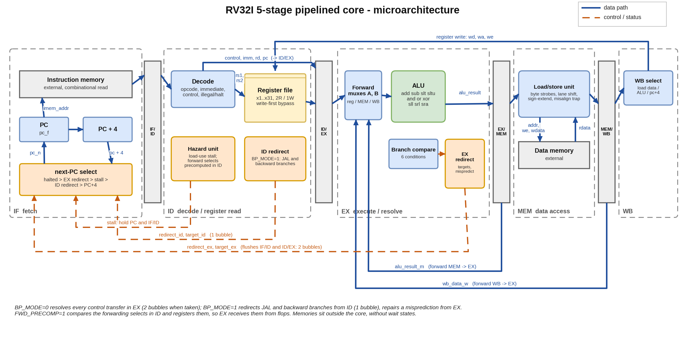
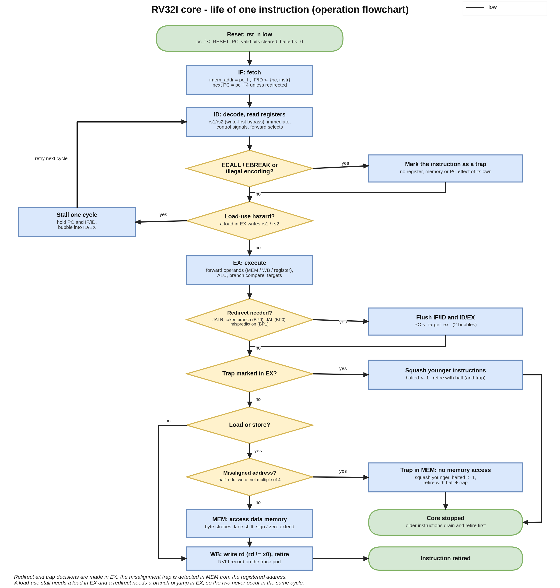
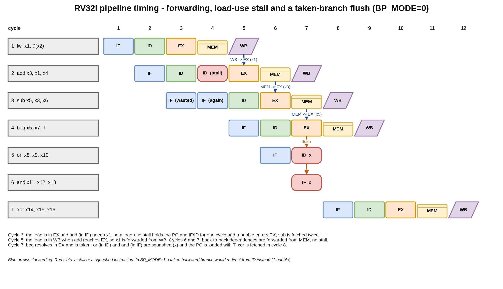

## A. Project overview

### A.1 Purpose

`rv32i_5stage_core` is a 5-stage in-order RV32I processor core written in SystemVerilog. It was built to demonstrate processor
microarchitecture in the way a design team would have to defend it: every architectural effect of every retired instruction is checked
against an independent instruction-set simulator, the pipeline-control rules are written down as assertions, the test environment is
itself tested by injecting deliberate bugs, and the clock period and cycle counts behind every performance statement come from tool
reports that are checked in next to the design.

### A.2 Problem statement and motivation

A pipelined core is easy to get *almost* right. Forwarding, the load-use stall, branch flushing and trap handling interact, and a core can
pass a few hand-written programs while carrying bugs that appear only for particular register-dependence distances or when a branch sits
behind a load. The motivation of this project is therefore twofold:

1. design a core whose hazard and control rules are small enough to state exactly; and
2. build a verification environment strong enough that a deliberately broken version of each rule is *detected* - and prove it by
   measuring how many injected bugs are caught and by which layer.

A second motivation is reproducibility: every number in this document is produced by a command in the repository and quoted from a
result file, and anything that was not measured says so.

### A.3 Scope and requirements

| ID | Requirement | Status |
|---|---|---|
| R1 | Implement the RV32I base ISA (all 37 user-level instructions; FENCE as a no-op; ECALL/EBREAK as halt) | implemented, checked against the ISS |
| R2 | 5-stage pipeline with full forwarding and a one-cycle load-use stall | implemented, checked |
| R3 | Branch and jump handling with a selectable control-hazard policy (resolve in EX, or static prediction from ID) | implemented, both policies checked |
| R4 | Byte, halfword and word loads and stores with the correct lane handling and sign/zero extension | implemented, checked |
| R5 | A retirement-trace port so each instruction can be compared with a reference | implemented (RVFI subset) |
| R6 | Trap handling for illegal encodings, misaligned accesses and misaligned branch / jump targets without corrupting architectural state | implemented as "stop and squash", checked (simulation and formal) |
| R7 | Measure CPI, minimum clock period and area; compare against a single-cycle core built from the same blocks | measured (section H) |
| R8 | Demonstrate that the verification environment can fail: injected-bug campaign | measured (section G) |

Out of scope, by decision: CSRs and interrupts, the M and C extensions, privilege modes, caches and bus protocols, wait states, and unbounded formal
proofs (the riscv-formal checks in section G.7 are bounded). Section I lists these as limitations.

### A.4 Target application and concepts exercised

The core is a teaching-and-portfolio class design: it fits an embedded controller that runs integer code out of tightly coupled
memories. The engineering concepts it exercises are pipeline hazards (RAW, load-use, control), operand forwarding, write-first
register-file bypass, static branch prediction, precise stop-on-trap behaviour, byte-lane handling in the load/store unit, retirement
tracing, lock-step co-simulation, constrained-random stimulus, assertion-based verification, coverage closure, mutation analysis,
logic synthesis, static timing analysis and critical-path-driven optimisation.

### A.5 Key features and measurable objectives

- All 37 RV32I instructions, 5-stage pipeline, steady-state CPI of 1.0 for hazard-free code.
- Two control-hazard policies selected by `BP_MODE`, two forwarding-select implementations selected by `FWD_PRECOMP`.
- One RVFI-style retirement port, removable by a parameter (`RVFI_EN=0`) so the synthesised core carries no verification hardware.
- Objective O1: every directed test, benchmark and random program matches the ISS instruction for instruction (pass/fail, section G).
- Objective O2: every injected bug is caught, and every assertion is shown to fire in at least one injected-bug run (section G).
- Objective O3: a measured CPI, minimum period and area for each configuration, and a measured execution-time comparison with a
  single-cycle core (section H).

---

## B. Architecture and block diagram

### B.1 Overview

The datapath follows the classic five stages. Instructions flow IF -> ID -> EX -> MEM -> WB through four pipeline registers (IF/ID, ID/EX,
EX/MEM, MEM/WB). Each pipeline register carries a *valid* bit; a bubble is a stage with `valid = 0` and every side-effect flag cleared, so a
bubble can never write a register, write memory, trigger a hazard or redirect the fetch.

The core has no knowledge of memory timing: the instruction port is a combinational read (`imem_addr` -> `imem_rdata`) and the data port is a
combinational read with a synchronous, byte-strobed write. Both memories live in the testbench or the surrounding system. The architecture
diagram is in section C; the block descriptions below refer to it.

### B.2 Modules and responsibilities

| Module | File | Responsibility | Combinational / sequential |
|---|---|---|---|
| `rv32i_core` | `rtl/rv32i_core.sv` | Pipeline registers, PC, next-PC select, flush/stall/redirect control, halt state, RVFI trace | both |
| `rv32i_decode` | `rtl/rv32i_decode.sv` | Opcode decode, immediate generation, control signals, illegal/ECALL/EBREAK detection | combinational |
| `rv32i_regfile` | `rtl/rv32i_regfile.sv` | 31 x 32-bit registers, two read ports, one write port, write-first bypass, x0 = 0 | both |
| `rv32i_alu` | `rtl/rv32i_alu.sv` | add, sub, slt, sltu, and, or, xor, sll, srl, sra | combinational |
| `rv32i_branch` | `rtl/rv32i_branch.sv` | BEQ, BNE, BLT, BGE, BLTU, BGEU comparison | combinational |
| `rv32i_lsu` | `rtl/rv32i_lsu.sv` | Store byte strobes and lane replication; load lane select and sign/zero extension; misalignment detection | combinational |
| `rv32i_hazard` | `rtl/rv32i_hazard.sv` | Load-use stall; forwarding selects (EX-stage compare, or ID-stage precompute) | combinational |
| `rv32i_core_1cyc` | `rtl/rv32i_core_1cyc.sv` | Single-cycle baseline built from the same blocks (measurement only) | both |
| `tb_core` | `tb/tb_core.sv` | 64 KiB unified memory model, trace writer, cycle accounting | testbench |
| `rv32i_checker` | `verif/rv32i_checker.sv` | Bound assertions and cover points | verification |

### B.3 Interfaces

`rv32i_core` ports (all signals are on the single clock `clk`; `rst_n` is a synchronous active-low reset):

| Signal | Dir | Width | Meaning |
|---|---|---:|---|
| `clk`, `rst_n` | in | 1 | clock; synchronous active-low reset |
| `imem_addr` | out | 32 | address of the instruction to fetch (`pc_f`), word aligned |
| `imem_rdata` | in | 32 | instruction word, combinational response |
| `dmem_addr` | out | 32 | word-aligned data address |
| `dmem_re` | out | 1 | read enable (suppressed on a misaligned access) |
| `dmem_we` | out | 4 | byte strobes for a store (zero for no write; suppressed on a misaligned access) |
| `dmem_wdata` | out | 32 | store data, positioned in its byte lanes |
| `dmem_rdata` | in | 32 | data word, combinational response |
| `halted` | out | 1 | sticky: the core has stopped after ECALL/EBREAK/illegal/misaligned |
| `rvfi_*` | out | various | retirement trace (valid, order, insn, pc_rdata, pc_wdata, rs1/rs2 addr and data, rd addr and data, mem addr/rmask/wmask/rdata/wdata, trap, halt); zero when `RVFI_EN=0` |

Parameters: `RESET_PC` (default 0), `BP_MODE` (0 or 1), `FWD_PRECOMP` (0 or 1), `RVFI_EN` (0 or 1).

### B.4 Data paths, control paths and pipeline registers

**Data path.** `imem_rdata` -> IF/ID -> decode -> (register read) -> ID/EX -> forwarding muxes -> ALU -> EX/MEM -> load/store unit and `dmem` ->
MEM/WB -> write-back select -> register file. Operand A of the ALU is `rs1`, the PC (AUIPC) or zero (LUI); operand B is `rs2` or the
immediate. JAL and JALR write `pc+4` instead of the ALU result.

**Forwarding path.** `alu_result_m` (EX/MEM) and `wb_data_w` (MEM/WB) feed the two forwarding muxes in front of the ALU and the branch
comparator. A load in MEM is never a forwarding source (its data is not ready); the load-use stall guarantees no consumer is ever in EX behind it.

**Control path.** `stall_d` (hazard unit) holds the PC and IF/ID and inserts a bubble into ID/EX. `redirect_ex` (EX) loads the PC from
`target_ex` and flushes IF/ID and ID/EX. `redirect_id` (ID, `BP_MODE=1`) loads the PC from `target_id` and flushes IF/ID. `trap_ex` and
`trap_mem` squash younger instructions and set the sticky `halted` flag, after which no new instruction enters the pipeline.

**Pipeline registers.**

| Register | Carries |
|---|---|
| IF/ID | `valid_d`, `pc_d`, `instr_d` |
| ID/EX | `valid_e`, control flags (reg_write, mem_read, mem_write, is_branch, is_jal, is_jalr, trap), `pc_e`, immediate, `rs1/rs2` data and addresses, `rd`, ALU op and operand selects, `funct3`, predicted-taken bit, and (with `FWD_PRECOMP=1`) the registered forwarding selects |
| EX/MEM | `valid_m`, reg_write, mem_read, mem_write, ALU/link result, store data, `rd`, `funct3` |
| MEM/WB | register-write flag, write-back data (load data or result), `rd` |

With `RVFI_EN=1` the instruction word, next PC, source values, memory records and halt/trap flags also travel down the pipeline.

### B.5 State machines

The core has no explicit FSM; its only control state is the per-stage valid bits and the sticky `halted` flag. The stall/flush behaviour
that an FSM would encode is a combinational function of the stage contents (section E.3), which is what makes it expressible as
assertions (section G.4).

---

## C. Draw.io architecture diagram

The diagram below is generated from one specification by `_tools/dgm.py`, which writes the editable draw.io file and the images from the
same objects so they cannot disagree. It shows the five stages, the pipeline registers, the data flow (blue), the control flow
(orange, dashed), the two forwarding paths that return to the EX stage, and the register-write loop from WB to the register file.



Diagram files (in `docs/diagrams/`): `rv32i_architecture.drawio` (editable source, open with diagrams.net or draw.io desktop),
`rv32i_architecture.png` (2800 px export), `rv32i_architecture.svg`, plus `rv32i_flowchart.*` and `rv32i_pipeline_timing.*`. The images are
rendered by `dgm.py` (matplotlib) with the same geometry as the `.drawio` file; they are not exports from the draw.io application.

---

## D. Design flowchart

### D.1 Operation from reset to retirement



Reading the flowchart: after reset (`pc_f` loaded with `RESET_PC`, valid bits cleared, `halted` cleared) the core fetches continuously. In ID an
ECALL, EBREAK or illegal encoding is marked as a trap (it has no effect of its own), and a load-use hazard stalls the instruction for one cycle.
EX resolves control transfers and acts on a marked trap; MEM performs the data access unless the address is misaligned; WB writes the register
and emits the retirement record. The exceptional paths (trap in EX, misaligned access in MEM) end in "core stopped": older instructions drain and
retire first, younger ones are squashed.

### D.2 Hazard timing example



The example executes `lw x1,0(x2); add x3,x1,x4; sub x5,x3,x6; beq x5,x7,T; or; and; ...` In cycle 3 the load is in EX and `add` (in ID) needs
x1, so the PC and IF/ID are held for a cycle and a bubble enters EX. In cycle 5 the load is in WB when `add` reaches EX and x1 is forwarded from
WB. `sub` and `beq` take their operands from MEM. In cycle 7 `beq` resolves as taken, the two younger instructions are squashed, and `xor` at the
target is fetched in cycle 8.

---

## E. Detailed design explanation

### E.1 Step-by-step operation

1. **Fetch.** `imem_addr = pc_f`. At the clock edge IF/ID captures `{pc, instruction}` unless the PC and IF/ID are being held (stall) or flushed.
2. **Decode.** `rv32i_decode` extracts `rs1`, `rs2`, `rd`, the immediate (I/S/B/U/J forms) and the control flags. The register file is read in the
   same cycle; a write in the same cycle to the register being read is bypassed (write-first), which makes the three-instructions-apart RAW distance
   free.
3. **Hazard check.** If the instruction in EX is a load whose destination equals a register this instruction reads, the instruction stalls one cycle.
4. **Execute.** The two operands pass through the forwarding muxes, the ALU computes (or the branch comparator decides), and the target adders compute
   `pc+imm` and, for JALR, `(rs1+imm) & ~1`. Control transfers redirect the fetch according to `BP_MODE`.
5. **Memory.** Loads and stores use `rv32i_lsu`: stores drive byte strobes and a lane-replicated word; loads select the addressed lane and extend it.
6. **Write-back.** The selected value is written to `rd` (unless `rd = x0`) and the RVFI record is emitted.

### E.2 Forwarding, in detail

Rule: for operand A (and identically B), the youngest older producer of `rs1` wins: if the instruction in MEM writes `rs1` (and `rs1 != x0`),
forward `alu_result_m`; otherwise if the instruction in WB writes `rs1`, forward `wb_data_w`; otherwise use the register-file value read in ID.

Two implementations of the same rule are provided:

- `FWD_PRECOMP=0` compares `rs1_e/rs2_e` against `rd_m/rd_w` in EX. The compares and the priority logic sit on the path that continues through the
  forwarding mux, the ALU or branch comparator and the redirect logic into the PC.
- `FWD_PRECOMP=1` performs the comparison one stage earlier. When the instruction is in ID, the producer now in EX will be in MEM and the producer now
  in MEM will be in WB when the instruction reaches EX, so the select can be computed from `rd_e`/`rd_m` and registered into ID/EX. EX then receives
  the select from flops. A load-use stall inserts a bubble and the select is recomputed on the following cycle, when the load has advanced.

The two are interchangeable by construction and by test: both pass every test, and the same assertions (written in terms of EX-stage register
contents) hold for both.

### E.3 Stall, flush and redirect

| Event | Detected in | Effect |
|---|---|---|
| Load-use hazard | ID (`stall_d`) | PC and IF/ID hold; bubble into ID/EX; the consumer re-enters EX one cycle later, with the load in WB |
| Taken branch / JAL (`BP_MODE=0`), JALR (both) | EX (`redirect_ex`) | PC <- `target_ex`; IF/ID and ID/EX flushed (2 bubbles) |
| JAL, backward branch (`BP_MODE=1`) | ID (`redirect_id`) | PC <- `target_id`; IF/ID flushed (1 bubble); mispredictions are repaired from EX (2 bubbles) |
| ECALL/EBREAK/illegal | EX (`trap_ex`) | younger instructions squashed, `halted` set |
| Taken branch, JAL or JALR whose target is not 4-byte aligned | EX (`misal_tgt_e`, folded into `trap_ex`) | no redirect, no link-register write, younger instructions squashed, `halted` set; a not-taken branch never traps. Found by the formal checks (G.7). With `BP_MODE=1` an ID redirect to a misaligned target is suppressed so that the PC never holds a misaligned value |
| Misaligned load/store | MEM (`trap_mem`) | memory access suppressed, younger instructions squashed, `halted` set |

Priority in the next-PC select: `halted` (hold) > `redirect_ex` > `stall_d` (hold) > `redirect_id` > `pc+4`. A load-use stall and an EX redirect cannot occur
in the same cycle (the first needs a load in EX, the second a branch or jump); an assertion records that no consumer slips past the stall.

### E.4 Load/store unit

For stores the unit replicates the byte or halfword across the word and asserts the matching strobes (byte: `0001 << addr[1:0]`; halfword: `0011` or
`1100`; word: `1111`), so the memory only needs to honour the strobes. For loads it shifts the returned word right by `8 * addr[1:0]` and then
sign- or zero-extends the byte or halfword. A halfword access at an odd address or a word access at a non-multiple-of-4 address is a *misaligned*
access: it is not performed and the instruction traps.

### E.5 Reset, latency, throughput, back-pressure and errors

- **Reset.** Synchronous, active-low. `pc_f <- RESET_PC`; the valid bits of IF/ID, ID/EX, EX/MEM and MEM/WB are cleared; `halted` is cleared. The
  register file is *not* reset by default (a reset would add a multiplexer per flop); programs initialise what they read.
- **Latency.** The first instruction retires four cycles after reset is released (the pipeline fill): `cycles = 4 + instret + bubbles`.
- **Throughput.** One instruction per cycle when there is no hazard. A load-use pair costs one bubble; a taken control transfer costs two bubbles
  (`BP_MODE=0`) or one (a correctly predicted backward branch or JAL, `BP_MODE=1`); a misprediction costs two.
- **Back-pressure.** There is none by design: the memories are assumed to respond in the same cycle. A real integration would add a global stall
  (hold every stage while a memory is not ready); that is listed under future work.
- **Errors.** The only error behaviour is stop-and-flag (`halted`, `rvfi_trap`, `rvfi_halt`).

### E.6 Key design decisions and trade-offs

| Decision | Alternatives | Reason / trade-off |
|---|---|---|
| Resolve branches in EX (policy 0) | resolve in ID with extra forwarding paths | EX has the forwarded operands already; ID resolution would need a comparator after a second forwarding network |
| Static BTFN from ID (policy 1) | dynamic predictor / BTB | smallest change that removes a bubble on every loop iteration; measured benefit in section H |
| Precomputed forwarding selects | keep compare in EX | takes the 5-bit compares and priority logic off the path that goes through the ALU/comparator into the PC; costs four flops and compare logic in ID |
| Stop-on-trap | CSRs and a trap vector | keeps the architectural model small and precise; honest about what is not implemented |
| RVFI port as a parameter | always present | lock-step checking needs it; PPA must not pay for it |
| Registers not reset | reset all | area; programs initialise their registers and the ISS rejects programs that read an unwritten one |
| Verilog-2005-friendly constructs (no structs/enums/packages) | SystemVerilog packages | the same source is read by Verilator 5.020 and Yosys 0.33 |

---

## F. Interface and timing details

### F.1 Clocking and reset

One clock domain, rising-edge flops, synchronous reset. There is no clock-domain crossing.

### F.2 Memory handshake

There is no valid/ready handshake: a read request and its response are in the same cycle. The timing assumptions the surrounding system must meet:

| Port group | Assumption used for timing (constraints/rv32i.sdc) |
|---|---|
| `imem_rdata`, `dmem_rdata` | arrive 2.0 ns after the clock edge (memory clock-to-output) |
| `imem_addr`, `dmem_addr`, `dmem_re`, `dmem_we`, `dmem_wdata`, `halted` | must be stable 1.0 ns (0.5 ns for `halted`) before the next edge |
| `rst_n` | arrives 0.5 ns after the edge, driven by a `buf_2` |

These numbers are assumptions about the environment, identical for all configurations, and are stated again next to every timing result.

### F.3 Write timing and read-after-write through memory

A store writes the memory at the end of its MEM cycle (strobes valid during the cycle). A later load of the same address therefore sees the new
data because it is at least one stage behind; no store-to-load forwarding is needed. The testbench ignores writes while reset is asserted, because
the core's flops hold unspecified values until the first reset edge.

### F.4 Supported conditions and limitations

Aligned 4-byte instruction fetch only (a taken branch, JAL or JALR to a target that is not 4-byte aligned traps in EX, see F.3 and G.7); data accesses
within the testbench's 64 KiB; no wait states; single hart.

---

## G. Verification and testing

### G.1 Objectives and test plan

| Objective | Evidence |
|---|---|
| Every architectural effect of every instruction is correct | lock-step with the ISS (trace and final memory) |
| The hazard and control rules hold exactly | bound assertions in both directions |
| The tests can fail | 73 injected bugs |
| The rules hold for every input within a bound, not only for the test programs | riscv-formal bounded checks (G.7) |
| The stimulus reaches the interesting corners | named cover points and line coverage |
| Neither the ISS nor the RTL is the only source of truth | expected values computed independently in the test generators |

### G.2 Testbench architecture

`tb_core` instantiates the core (or the single-cycle baseline), a unified memory (instruction and data ports see the same array), a trace writer and
cycle counters. Programs are assembled by `tools/rvasm.py` into a hex image; the ISS `tools/rviss.py` runs the same image and writes its own trace;
`tools/compare_trace.py` compares the two traces field by field (memory data only in the byte lanes the mask marks), and the runner compares the final
memory images and reads the program's own verdict (register `a0`) from the dump. Each test also enables the bound assertions.

### G.3 Directed and random tests

Directed tests (`tools/gen_directed.py`, expected values computed in the generator):

| Test | What it exercises |
|---|---|
| t01 | every register-register ALU operation over a 10 x 10 operand grid including 0, 1, INT_MIN, INT_MAX, all-ones and shift amounts up to 31 |
| t02 | immediate forms, LUI, AUIPC |
| t03 | all load/store sizes, every byte lane, sign and zero extension, neighbouring bytes untouched |
| t04 | the six branches, taken and not taken, signed/unsigned boundaries, loops with trip counts 1 to 100, nested loops |
| t05 | RAW dependences at distance 1 to 4 on each operand, forwarding priority (MEM over WB), x0 as destination and source, store address and data forwarding |
| t06 | load followed by a consumer in every operand position, store data/address, branch operands, JALR target, pointer chasing, load into x0 |
| t07 | wrong-path squash after taken branches/JAL/JALR, link values, nested call/return, back-to-back branches |
| t08a-r | illegal encodings, CSR, misaligned loads/stores (memory must not change), EBREAK, ECALL squashing younger instructions, a trap behind a load-use stall; misaligned JAL / JALR / taken BEQ (forward and backward) targets (trap, no link write), a misaligned JALR right behind a load-use stall, and a not-taken branch with a misaligned offset (no trap) |
| t09, t10 | FENCE and x0 behaviour; a backward branch whose operand comes straight from the preceding load (stall on a predicted-taken branch) |

Benchmarks (`tools/gen_bench.py`, results checked against Python): Fibonacci, memcpy, bubble sort, sieve, bitwise CRC-32 (against `zlib.crc32`),
linked-list walk, 6 x 6 matrix multiply with a software multiply and call/return.

Constrained-random programs (`tools/rvgen.py`): the constraints are listed in the README (instruction mix, dependency bias, load-use bias, edge-value
operands, forward branches over wrong-path filler, counted and memory-resident loops, JALR through computed addresses, rare trap endings).

Measured results (from `results/directed.txt`, `results/random.txt`, `results/cpi.md`):

| Test class | Result |
|---|---|
| Directed tests | 28/28 tests passed (BP_MODE 0,1) |
| Constrained-random programs | 200/200 tests passed (BP_MODE 0,1); 161597 instructions retired and compared |
| Benchmarks (self-checking, both BP modes) | all 7 pass; table in H.3 |

### G.4 Assertions and properties

`verif/rv32i_checker.sv` is bound into the core and holds 48 labelled assertions. The groups:

- **Forwarding**: `a_fwd_{a,b}_{mem,wb}_{only,always}` and `a_fwd_{a,b}_none` state the rule in both directions for valid instructions.
- **Load-use**: `a_stall_always` / `a_stall_only` (the stall is exactly the hazard), `a_stall_bubble`, `a_stall_holds_pc`, `a_stall_holds_id`,
  `a_no_load_use_slip` (a consumer is never in EX directly behind the load that feeds it).
- **Control flow**: `a_jalr_redirects`, `a_redirect_only`, `a_taken_redirects`, `a_nt_no_redirect`, `a_no_id_redirect`, `a_mispredict`, `a_predict_ok`,
  `a_jal_in_id`, `a_id_redirect_only`, `a_btfn`, `a_ex_flush_two`, `a_id_flush_one`, `a_ex_target`, `a_pc_aligned`, `a_misal_traps`, `a_misal_only`.
- **Traps**: `a_halted_sticky`, `a_halted_drains`, `a_trap_squashes`, `a_trap_mem_squash_m`, `a_no_retire_after_halt`, `a_trap_no_write`.
- **Side effects**: `a_rw_valid_m`, `a_mem_valid_m`, `a_we_only/always`, `a_re_only/always`, `a_store_strobe_lane`.
- **Trace**: `a_x0_no_write`, `a_order_counts`, `a_trap_implies_halt`.

Verilator 5.020 supports implication and `$past` but not `##` sequence delays or covergroups, so functional coverage is expressed as named
`cover property` points.

### G.5 Coverage

Merged coverage of the directed tests, the benchmarks and random programs, both BP modes (`results/coverage_summary.txt`):

```text
source               : /home/abhi/Documents/VLSI/Resume_projects/rv32i_5stage_core/build/cov/merged.dat
named cover bins     : 143 total, 143 hit, 0 zero
rtl/ line blocks    : 117 total, 115 covered, 2 excluded, 0 uncovered
rtl/ files with no line records : rv32i_core_1cyc.sv (procedural blocks only are recorded; these are covered by toggle coverage, the cover bins and the assertions, not by the line gate)
rtl/ branches       : 72 total, 59 hit (reported, not gated)
rtl/ toggle bits    : 3853 total, 3773 toggled, 80 unhit (reported, not gated)
```

### G.6 Checking the checks: injected bugs

`scripts/mutants.py` applies each of 73 one-line RTL bugs (listed in `verif/mutants.py`) to a copy of the RTL, builds it with and without the bound
assertions, and runs the directed tests and 40 random programs against it. The campaign fails if any bug escapes every layer, if an assertion meant to
trip does not, or if any assertion is never shown to fire.

Result of the campaign (`results/mutants.txt`, first lines):

```text
mutants: 73, caught 73
test set per mutant: 28 directed + 40 random programs, lock-step vs ISS
caught ONLY by an assertion (the other layers missed them): M07, M29, M33, M49, M50, M53, M58, M59, M60, M61, M63, M72, M73
assertions defined: 48; fired in at least one mutant run: 48
assertions with no mutant bound: none
assertions that fired in no run: none
PROBLEMS: none
```

What the campaign taught (kept because it is the most useful result of the project):

- The first campaign exposed a stimulus gap: a load-use stall on a backward branch that `BP_MODE=1` predicts taken survived every test. A directed
  test (`t10`) and a random-generator class (memory-resident loop counters) were added and the bug is now caught.
- Several assertions caught bugs that no other layer sees at all (performance-only bugs such as a needless stall, and squash bugs whose only
  victim is an instruction that never retires). They are marked "caught only by an assertion" in the result.
- A cover point written as `$past(stall_d) && valid_e` was unreachable by construction (the instruction after a stall is a bubble); coverage
  closure exposed it and it was corrected to `$past(stall_d, 2)`.
- Of the 48 assertions, one (`a_no_id_redirect`, which says ID redirects do not exist in `BP_MODE=0`) is only violated by a redundant, not an
  incorrect, redirect - it is a design-intent assertion rather than a functional one.

- The formal checks (G.7) later found a defect that all of the above had missed, because no test program ever jumped to a misaligned target: the fix
  came with six more injected bugs (M69 to M74), three assertions and six directed tests.

### G.6.1 Simulation commands and tools

```bash
make check      # lint, self-tests, directed tests, benchmarks, 100 random programs, coverage
make mutants    # the injected-bug campaign
make formal     # riscv-formal bounded checks (G.7); needs SymbiYosys, z3 and a riscv-formal checkout under ../../_toolchain
```

Requires Verilator (5.020 or newer), Python 3, GNU make; Yosys and OpenSTA for section H; SymbiYosys 0.33, z3 and riscv-formal for `make formal`.

### G.7 Formal verification (riscv-formal, bounded)

The core's RVFI port is wired to the riscv-formal harness (`formal/wrapper.sv`; instruction memory and load data are free inputs) and checked with
SymbiYosys and z3 for all four `BP_MODE` x `FWD_PRECOMP` variants: one check per RV32I instruction (37), plus register-file consistency, PC
consistency forward and backward, instruction uniqueness, causality and the illegal-instruction rule (6): 43 checks per variant.

Result of the bounded checks on the current core (`results/formal.txt`):

```text
riscv-formal bounded model checks of rv32i_core (RVFI_EN=1), SymbiYosys + z3, Yosys 0.33, isa rv32i, one retirement channel
instruction memory and load data are free inputs; reset is asserted in the first cycle; RISCV_FORMAL_ALIGNED_MEM
BOUNDED checks (the depth is the number of cycles from reset explored), not unbounded proofs. depth per check family: insn 12, reg 14, pc_fwd 14, pc_bwd 14, unique 14, causal 14, ill 12

BP_MODE=0 FWD_PRECOMP=0 : 43 checks, 43 PASS, 0 not PASS
    causal 1/1, ill 1/1, insn 37/37, pc_bwd 1/1, pc_fwd 1/1, reg 1/1, unique 1/1
BP_MODE=0 FWD_PRECOMP=1 : 43 checks, 43 PASS, 0 not PASS
    causal 1/1, ill 1/1, insn 37/37, pc_bwd 1/1, pc_fwd 1/1, reg 1/1, unique 1/1
BP_MODE=1 FWD_PRECOMP=0 : 43 checks, 43 PASS, 0 not PASS
    causal 1/1, ill 1/1, insn 37/37, pc_bwd 1/1, pc_fwd 1/1, reg 1/1, unique 1/1
BP_MODE=1 FWD_PRECOMP=1 : 43 checks, 43 PASS, 0 not PASS
    causal 1/1, ill 1/1, insn 37/37, pc_bwd 1/1, pc_fwd 1/1, reg 1/1, unique 1/1

scope: 37 per-instruction checks (every RV32I instruction except FENCE / ECALL / EBREAK / CSR), plus reg (register x5 only), pc_fwd and pc_bwd (parameter 5),
  unique, causal (parameter 5) and ill (an all-zero word must trap). NOT RUN: liveness / hang, the memory-bus checks, CSR checks (no CSRs),
  and any unbounded (k-induction / PDR) proof; FENCE, ECALL and EBREAK are not covered by an instruction check.

all variants: 172 of 172 checks PASS
```

Result of the same checks on the core before the fix (`results/formal_as_found.txt`):

```text
riscv-formal on the core before the misaligned-target fix (formal/as_found/rv32i_core.sv), BP_MODE=0 FWD_PRECOMP=1
BP_MODE=0 FWD_PRECOMP=1 : 43 checks, 35 PASS, 8 FAIL
failing checks:
  insn_beq_ch0  (FAIL 0 15)
  insn_bge_ch0  (FAIL 0 24)
  insn_bgeu_ch0  (FAIL 0 23)
  insn_blt_ch0  (FAIL 0 26)
  insn_bltu_ch0  (FAIL 0 24)
  insn_bne_ch0  (FAIL 0 21)
  insn_jal_ch0  (FAIL 0 21)
  insn_jalr_ch0  (FAIL 0 17)
failing assertion: rvfi_insn_check.sv line 196, assert(spec_trap == trap): the specification says the transfer traps, the core did not
```

**What the first run found.** On the core as it was, eight checks failed (the pre-fix core was run in one variant only, `BP_MODE=0` `FWD_PRECOMP=1`): all six conditional branches, JAL and JALR. The
specification says a taken branch, JAL or JALR whose target is not 4-byte aligned (no C extension) raises instruction-address-misaligned; the core jumped
there. The ISS rejected such programs and an assertion flagged a misaligned PC, but no test program ever produced one, so simulation never saw it. The
fix is in EX (`misal_tgt_e`): the transfer traps, writes no link register and does not redirect. The ISS, the single-cycle baseline, the directed tests
(`t08m` to `t08r`), the checker (`a_misal_traps`, `a_misal_only`, `a_trap_no_write`) and the mutant list (M69 to M74) were extended to match. The pre-fix core is
kept in `formal/as_found/` and `formal/run_as_found.sh` reproduces the eight failures (`results/formal_as_found.txt`).

**What this is and is not.** Bounded model checking explores every input sequence up to the stated depth from reset; it is not an unbounded proof. Not run:
liveness, the memory-bus checks, CSR checks (no CSRs), `reg` for registers other than x5, and checks for FENCE, ECALL and EBREAK (the riscv-formal
instruction set has no check for them; they are covered by the directed tests and the ISS).

### G.8 Known failures and gaps

No test fails. Gaps: formal checking is bounded (G.7), no riscv-tests/arch-tests (no RISC-V toolchain), the single-cycle baseline is verified by
lock-step but has no bound assertions or coverage of its own.

---

## H. Synthesis, timing and performance results

### H.1 Method

Yosys 0.33 maps the core (RVFI removed) to Sky130 HD; two mappings are compared: Yosys' default `abc -D` (no buffering) and a timing-driven ABC
script (`scripts/abc_speed.script`: delay mapping, fan-out buffering, gate sizing). OpenSTA times each netlist with `constraints/rv32i.sdc`. The
minimum period is `T_min = 10 ns - WNS(10 ns)` and is *verified* by re-running STA at +/-2 % of T_min. All figures are pre-layout (ideal clock, no
wires), typical corner (`tt_025C_1v80`).

RVFI trace port removed (RVFI_EN=0). Ideal clock, no wires, no placement. Memory budget in the SDC: read data 2.0 ns after the edge, address/write data 1.0 ns before the next edge (assumption, identical for all rows). `speed` = timing-driven ABC script, `default` = `abc -D 10000`.

| core | mapping | cells | area (um^2) | flip-flops | T_min (ns) | F_max (MHz) | method check (+2 % meets, -2 % fails) |
|---|---|---:|---:|---:|---:|---:|---|
| 5-stage BP_MODE=0 FWD_PRECOMP=0 | speed | 6951 | 75452 | 1371 | 5.549 | 180.2 | verified (WNS +0.111 / -0.111 ns) |
| 5-stage BP_MODE=0 FWD_PRECOMP=1 | speed | 6906 | 75275 | 1365 | 4.330 | 230.9 | verified (WNS +0.086 / -0.087 ns) |
| 5-stage BP_MODE=1 FWD_PRECOMP=0 | speed | 7374 | 77986 | 1372 | 6.072 | 164.7 | verified (WNS +0.122 / -0.121 ns) |
| 5-stage BP_MODE=1 FWD_PRECOMP=1 | speed | 7396 | 77594 | 1366 | 4.842 | 206.5 | verified (WNS +0.097 / -0.097 ns) |
| single-cycle | speed | 6326 | 66975 | 1025 | 8.746 | 114.3 | verified (WNS +0.175 / -0.175 ns) |
| 5-stage BP_MODE=0 FWD_PRECOMP=1 | default | 6750 | 69276 | 1365 | 20.191 | 49.5 | verified (WNS +0.404 / -0.404 ns) |
| 5-stage BP_MODE=1 FWD_PRECOMP=1 | default | 7070 | 71540 | 1366 | 18.184 | 55.0 | verified (WNS +0.364 / -0.364 ns) |
| single-cycle | default | 7140 | 59023 | 1025 | 25.407 | 39.4 | verified (WNS +0.508 / -0.508 ns) |

### H.2 Critical paths

- With `FWD_PRECOMP=0` the limiting path starts at the WB destination register, runs through the 5-bit compares and the forwarding select, the
  forwarded operand into the branch comparator, and the redirect logic into the PC.
- With `FWD_PRECOMP=1` the select comes from a flop. T_min falls accordingly (table above). The limiting path is then the forwarded operand through
  the ALU/comparator and the redirect logic.
- Limiting paths in the re-synthesised netlists (read from `build/ppa/*/timing.txt` and `synth.v`; start flop to end flop, Yosys names): `BP_MODE=0`
  `FWD_PRECOMP=0`: `u_hazard.rd_w[0]` to `pc_d[10]`; `BP_MODE=1` `FWD_PRECOMP=0`: the same pair; `BP_MODE=0` `FWD_PRECOMP=1`: `fwd_b_r[2]` (the registered
  forwarding select) to a flop named `u_decode.imm_j[17]` (a merged flop; not interpreted further); `BP_MODE=1` `FWD_PRECOMP=1`: `fwd_b_r[2]` to
  `imem_addr[30]` (the PC register). The same configuration's T_min moved between RTL revisions by up to 8 % (6.024 to 5.549 ns) (`results/ppa_before_misaligned_fix.md`
  against `results/ppa.md`), which is the mapping's sensitivity to small RTL changes, so small differences between rows are not conclusions.
- Plain `abc -D` without buffering gives periods several times longer than the timing-driven mapping for the same RTL: the figure is dominated by
  high-fan-out nets, not by the design. Every design conclusion uses the timing-driven rows.

### H.3 CPI and bubble sources

| benchmark | instructions | BP_MODE 0 cycles | CPI | load-use stalls | EX redirects | BP_MODE 1 cycles | CPI | ID redirects | EX redirects | overlap | CPI change |
|---|---:|---:|---:|---:|---:|---:|---:|---:|---:|---:|---:|
| b_bubblesort | 13209 | 20123 | 1.523 | 1128 | 2891 | 17914 | 1.356 | 2353 | 634 | 48 | -11.0 % |
| b_crc32 | 9684 | 14476 | 1.495 | 192 | 2298 | 13325 | 1.376 | 1730 | 954 | 193 | -8.0 % |
| b_fib | 522 | 710 | 1.360 | 0 | 92 | 621 | 1.190 | 92 | 2 | 1 | -12.5 % |
| b_listwalk | 712 | 1360 | 1.910 | 320 | 162 | 1201 | 1.687 | 162 | 2 | 1 | -11.7 % |
| b_matmul | 21644 | 31802 | 1.469 | 36 | 5059 | 27966 | 1.292 | 3968 | 1179 | 44 | -12.1 % |
| b_memcpy | 2894 | 4436 | 1.533 | 512 | 513 | 3928 | 1.357 | 514 | 3 | 2 | -11.5 % |
| b_sieve | 33604 | 51768 | 1.541 | 2044 | 8058 | 43861 | 1.305 | 8087 | 91 | 60 | -15.3 % |
| **all (sum)** | 82269 | 124675 | 1.515 | | | 108816 | 1.323 | | | | -12.7 % |

Cycle accounting: accounted = 4 + instret + load-use stalls + 2 x EX redirects + ID redirects. BP_MODE 0: cycles == accounted (exact). BP_MODE 1: cycles <= accounted; `overlap` = accounted - cycles, slots squashed twice. Check: holds for all 14 runs

### H.4 Execution time and the comparison with the single-cycle core

T_min (ns, pre-layout, timing-driven mapping): single-cycle = 8.746, 5-stage BP0, EX-compare fwd = 5.549, 5-stage BP0, ID-precomputed fwd = 4.330, 5-stage BP1, ID-precomputed fwd = 4.842

Execution time in microseconds (cycles x T_min). Lower is better. Speed-up is relative to the single-cycle core.

| benchmark | instructions | single-cycle (us) | 5-stage BP0, EX-compare fwd (us) | 5-stage BP0, ID-precomputed fwd (us) | 5-stage BP1, ID-precomputed fwd (us) | best 5-stage speed-up |
|---|---:|---:|---:|---:|---:|---:|
| b_bubblesort | 13209 | 115.5 | 111.7 | 87.1 | 86.7 | 1.33x |
| b_crc32 | 9684 | 84.7 | 80.3 | 62.7 | 64.5 | 1.35x |
| b_fib | 522 | 4.6 | 3.9 | 3.1 | 3.0 | 1.52x |
| b_listwalk | 712 | 6.2 | 7.5 | 5.9 | 5.8 | 1.07x |
| b_matmul | 21644 | 189.3 | 176.5 | 137.7 | 135.4 | 1.40x |
| b_memcpy | 2894 | 25.3 | 24.6 | 19.2 | 19.0 | 1.33x |
| b_sieve | 33604 | 293.9 | 287.3 | 224.2 | 212.4 | 1.38x |
| **all** | 82269 | 719.5 | 691.8 | 539.8 | 526.9 | **1.37x** |

Speed-up of each 5-stage configuration over the single-cycle core, all benchmarks together: 5-stage BP0, EX-compare fwd 1.04x, 5-stage BP0, ID-precomputed fwd 1.33x, 5-stage BP1, ID-precomputed fwd 1.37x

Read with: pre-layout, ideal memories (2.0 ns read / 1.0 ns write budget assumed), 7 small kernels (82269 instructions), not a standard benchmark suite. The single-cycle figure is optimistic (see the script header), so these speed-ups are lower bounds under this model.

### H.5 Measured, estimated, and not measured

| Item | Status |
|---|---|
| Cycle counts, CPI, bubble sources | measured in RTL simulation |
| Minimum period, area, cell and flop counts | measured by Yosys + OpenSTA (pre-layout) |
| Execution time | derived: measured cycles x measured T_min |
| Routed setup / hold slack, router DRC count, area after place and route (one configuration, nine target periods) | measured by OpenROAD (H.6) |
| Frequency in silicon, signoff DRC / LVS, power with a real workload, routed results for the other configurations | NOT MEASURED |
| Behaviour with real memories (wait states, caches) | NOT MEASURED |

### H.6 Place and route (OpenROAD)

The `BP_MODE=1`, `FWD_PRECOMP=1` core (the fastest configuration in H.1) was placed and routed with OpenROAD on Sky130 HD at nine target clock periods
(`pnr/`, `make pnr`). The flow is the one `alu_fifo` used (floorplan, global placement, repair, clock-tree synthesis, repair_timing, global and detailed
routing, antenna repair, SPEF extraction, final STA on the extracted parasitics) with the same untuned settings. Every run was read back and checked by
`pnr/pnr_report.py` before its numbers were used.

Flow: floorplan at the stated utilisation, global placement, repair_design, clock-tree synthesis, repair_timing, global and detailed routing, antenna repair, RC extraction (SPEF), final STA with the propagated clock on the extracted parasitics (`pnr/pnr_flow.tcl`, adapted from alu_fifo). Netlist: the timing-driven Yosys mapping of `make ppa`. Constraints: `constraints/rv32i.sdc` (memory read 2.0 ns after the edge, address/write data 1.0 ns before the next edge: an assumption). Typical corner only; no hold fixing beyond what repair_timing did; no signoff DRC/LVS (Magic/KLayout/Netgen are not installed), so "DRC" below is the router's own count. Power is OpenSTA's default-activity figure, not a workload figure.

| run | target period (ns) | setup WNS (ns) | hold WNS (ns) | TNS (ns) | route DRC | antenna viol. | slew / cap / fanout viol. | design area (um^2) | die (um) | checks |
|---|---:|---:|---:|---:|---:|---:|---|---:|---|---|
| bp1_fwd1_p10.0 | 10.0 | +0.626 | +0.091 | 0.000 | 0 | 0 | 61 / 5 / 0 | 79330 | 450 x 450 | all passed |
| bp1_fwd1_p6.0 | 6.0 | -0.575 | -0.131 | -45.888 | 0 | 0 | 16 / 5 / 0 | 81775 | 450 x 450 | all passed |
| bp1_fwd1_p7.0 | 7.0 | -0.554 | +0.117 | -27.181 | 0 | 0 | 21 / 3 / 0 | 79922 | 450 x 450 | all passed |
| bp1_fwd1_p8.0 | 8.0 | -0.303 | +0.093 | -5.719 | 0 | 0 | 17 / 7 / 0 | 79534 | 450 x 450 | all passed |
| bp1_fwd1_p8.4 | 8.4 | -0.538 | +0.073 | -33.977 | 0 | 0 | 26 / 8 / 0 | 79420 | 450 x 450 | all passed |
| bp1_fwd1_p8.6 | 8.6 | -0.774 | +0.091 | -23.009 | 0 | 0 | 61 / 5 / 0 | 79330 | 450 x 450 | all passed |
| bp1_fwd1_p8.8 | 8.8 | -0.574 | +0.091 | -6.151 | 0 | 0 | 61 / 5 / 0 | 79330 | 450 x 450 | all passed |
| bp1_fwd1_p9.0 | 9.0 | -0.374 | +0.091 | -1.313 | 0 | 0 | 61 / 5 / 0 | 79330 | 450 x 450 | all passed |
| bp1_fwd1_p9.5 | 9.5 | +0.126 | +0.091 | 0.000 | 0 | 0 | 61 / 5 / 0 | 79330 | 450 x 450 | all passed |

Worst routed setup path per run (start flop output net -> end flop input net, names from the post-repair netlist):

- `bp1_fwd1_p10.0`: `b_imm_e` -> `result_e[27]` (setup slack +0.626 ns)
- `bp1_fwd1_p6.0`: `\u_regfile.wd [29]` -> `_00363_` (setup slack -0.575 ns)
- `bp1_fwd1_p7.0`: `\u_regfile.wd [4]` -> `_00785_` (setup slack -0.554 ns)
- `bp1_fwd1_p8.0`: `b_imm_e` -> `_00789_` (setup slack -0.303 ns)
- `bp1_fwd1_p8.4`: `fwd_a_r[0]` -> `_00332_` (setup slack -0.538 ns)
- `bp1_fwd1_p8.6`: `b_imm_e` -> `result_e[27]` (setup slack -0.774 ns)
- `bp1_fwd1_p8.8`: `b_imm_e` -> `result_e[27]` (setup slack -0.574 ns)
- `bp1_fwd1_p9.0`: `b_imm_e` -> `result_e[27]` (setup slack -0.374 ns)
- `bp1_fwd1_p9.5`: `b_imm_e` -> `result_e[27]` (setup slack +0.126 ns)

Clock-tree sinks equal the flip-flop count in every accepted run; the netlist checksum matches the one recorded at the start of the run.

**Smallest tried target that closed setup and hold in the routed, extracted design with zero route DRC violations: 9.5 ns (105.3 MHz)**, run `bp1_fwd1_p9.5`. This is the best of the targets that were run (a tested value, not an optimum): finer steps below it were not tried.
The pre-layout minimum period of the same configuration is 4.842 ns (`results/ppa.md`); the smallest closing routed target is 1.96x that (derived: 9.5 / 4.842).
Selected run: bp1_fwd1_p9.5 | target 9.5 ns | 105.3 MHz | setup WNS +0.126 ns | hold WNS +0.091 ns | route DRC 0 | antenna violations 0 | area 79330 um^2
In that run the routed design still has 61 max-slew, 5 max-capacitance and 0 max-fanout violating pins/nets (`check_types_final.rpt`; 9 of the violating pins are antenna diodes).
Power, default activity (W): 9.90e-03. Design area before fillers: 79330 um^2 at 41.2 % utilisation. Clock skew report: Clock clk 1.216 source latency _11552_/CLK ^ -1.345 target latency _11599_/CLK ^ -0.130 setup skew

Runs bp1_fwd1_p8.6, bp1_fwd1_p8.8, bp1_fwd1_p9.0, bp1_fwd1_p9.5, bp1_fwd1_p10.0 have identical area and violation counts (repair_timing changed nothing at those targets) and their setup slack moves one for one with the period: the routed critical path of that layout is 9.374 ns (target minus slack, derived).

Run settings: core utilisation 40 %, repair_setup_margin 0.3 ns, global placement density 0.60 (alu_fifo's values, not tuned for this design); antenna repair between global and detailed routing: bp1_fwd1_p10.0 off, bp1_fwd1_p6.0 off, bp1_fwd1_p7.0 off, bp1_fwd1_p8.0 off, bp1_fwd1_p8.4 off, bp1_fwd1_p8.6 off, bp1_fwd1_p8.8 off, bp1_fwd1_p9.0 off, bp1_fwd1_p9.5 off.

What the table says and does not say:

- The routed design closes setup and hold with zero router DRC violations from 9.5 ns upward and not at any shorter target that was tried. The pre-layout
  minimum period of the same configuration is 4.842 ns (ideal clock, no wires). The routed figure is therefore about twice the pre-layout one; how much of that
  is clock-tree insertion delay and skew (about 1.2 to 1.4 ns of latency and 0.13 to 0.17 ns of skew in the clock reports), how much is wire load and how much is
  the repair step's choices was **not decomposed**.
- Results are not monotonic in the target period: the 8.0 ns run ended 0.303 ns short while the 8.4 ns run ended 0.538 ns short, and from 8.6 ns upward
  `repair_timing` changed nothing, so those layouts are identical and only the period moves the slack. The 9.5 ns result is a tested value, not an optimum;
  steps finer than those listed were not tried.
- The shortest target (6.0 ns) also ends with a hold violation (-0.131 ns). Its worst hold path starts at the `rst_n` input, whose SDC input delay is 0.5 ns,
  and ends at a flop whose clock arrives 1.33 ns after the clock port: the SDC gives inputs no clock-latency allowance, so this is partly an artefact of the
  constraints and not a finding about the design.
- Max-slew and max-capacitance violating pins remain in every routed run (61 and 5 in the 9.5 ns run, 9 of the 66 being antenna-diode pins; the worst slew is 0.398 ns
  over the limit, on a net that drives mux select pins); they were reported, not fixed.
- Only this one configuration was routed. The other three pipelined configurations and the single-cycle baseline were not, so no routed speed-up is
  claimed: the speed-up in H.4 remains a pre-layout figure.
- Signoff DRC and LVS are NOT RUN (Magic, KLayout and Netgen are not installed). "DRC" means the router's own count. Power is OpenSTA's default-activity
  estimate for the extracted design, not a workload measurement.
- Two of the first three runs stopped with an OpenROAD error (GRT-0183) in the antenna repair between global and detailed routing; the runs reported here skip
  that step (`PNR_GRT_ANTENNA=0`), and the antenna repair after detailed routing still ran (0 antenna violations at the end). The logs of the failed runs are in
  `results/pnr_grt_antenna/`. A mistake of my own is recorded too: one run was damaged by editing the flow script while OpenROAD was reading it, and
  its log is in `results/pnr_aborted/`; it was rerun.

---

## I. Results, limitations and future improvements

### I.1 Summary

The core implements all of RV32I, passes every directed test, benchmark and random program in lock-step with an independent ISS, satisfies all 48
assertions, is closed on its cover points, has every one of its 73 injected bugs caught, and passes 172 of 172 bounded riscv-formal checks over its four
configurations (G.7). The measured pipeline gain over the same-RTL single-cycle core is modest (the table in H.4): a pipelined core is only as fast
as its critical path. With the forwarding compare in EX the pipeline measured 0.92x of the single-cycle baseline when first measured and 1.04x after the
misaligned-target fix (`results/performance_before_misaligned_fix.md`, `results/performance.md`): not clearly better, and the change between the two runs
came with a fix that added logic, so it is mapping variation. With the compare moved out of EX it measured 1.27x then 1.33x (`BP_MODE=0`) and 1.37x both times (`BP_MODE=1`).

### I.2 Most meaningful engineering outcomes

1. A **measured** performance comparison, including the unflattering one: the straightforward pipeline did not clearly beat the baseline (0.92x, then
   1.04x on re-synthesis); a critical-path-driven change gave 1.33x to 1.37x, and both variants are kept and verified.
2. A **verification environment that can fail**, shown with an injected-bug campaign whose gaps were found and closed.
3. An **independent reference model and assembler** built for the project, so no part of the evidence depends on a RISC-V toolchain.

### I.3 Limitations

No CSRs/interrupts/M/C; stop-on-trap; ideal memories without wait states; static prediction only; pre-layout timing
only (one configuration routed, no signoff checks); formal checks are bounded, not proofs; the single-cycle comparison is optimistic for the baseline (section H).

### I.4 Future improvements

- A global stall for memory wait states, then an instruction cache and a data cache (the `mlc_cache_controller` project is the natural partner).
- Zicsr, machine-mode traps and interrupts, then the M extension (a pipelined multiplier and an iterative divider).
- Dynamic branch prediction with a small BTB; measure it with the same benchmarks and the same cycle accounting.
- Unbounded formal proofs (k-induction or PDR) for the riscv-formal properties, the liveness checks, and the riscv-arch-test suite once a RISC-V toolchain is available.
- Route the other three pipelined configurations and the single-cycle baseline (the same flow), fix the remaining max-slew violations, and run signoff DRC / LVS when Magic, KLayout and Netgen are available.

### I.5 Interview talking points

- Why the load-use stall exists and why a load in MEM is never a forwarding source; the assertion that records it.
- Why MEM must beat WB in the forwarding priority, and the test (`t05`) and mutants (M03, M43) that prove it.
- How precomputing forwarding selects in ID changes the critical path, what it costs (four flops), and the before/after numbers.
- What a taken branch costs under each policy and how the cycle-accounting identity was used to check the counters (and why it is an inequality for `BP_MODE=1`).
- How the lock-step trace works (RVFI subset) and why the memory lanes are compared under the byte mask.
- Why the mutation campaign was worth running: the stalled predicted-taken-branch hole, the unreachable cover, and the assertion-only kills.
- What is not claimed: no silicon frequency, no power, a lower-bound speed-up against an optimistic baseline.

---

## J. References and reproducibility

### J.1 References

- *The RISC-V Instruction Set Manual, Volume I: Unprivileged ISA* (RV32I base), RISC-V International.
- RISC-V Formal Interface (RVFI) specification, in the riscv-formal project documentation.
- D. Patterson and J. Hennessy, *Computer Organization and Design, RISC-V Edition*, pipelining chapter (hazards, forwarding, branch handling).
- Verilator documentation (assertions, coverage); Yosys manual (`synth`, `abc`, `dfflibmap`); OpenSTA documentation.
- SkyWater SKY130 high-density standard-cell library (`sky130_fd_sc_hd`), typical corner liberty.

### J.2 Directory structure

```
rv32i_5stage_core/
  rtl/        rv32i_defs.vh alu branch regfile decode lsu hazard core core_1cyc
  tb/         tb_core.sv
  verif/      rv32i_checker.sv checker_binds.sv mutants.py cov_exclusions.txt sim_main.cpp
  tools/      rvasm.py rviss.py rvgen.py compare_trace.py run_tests.py gen_directed.py gen_bench.py selftest_asm.py
  tests/      asm/ (28 directed)  bench/ (7 benchmarks)
  scripts/    build_sim.sh mutants.py cov_run.py ppa.py fmax.py cpi_report.py perf_report.py ...
  formal/     wrapper.sv checks.cfg.in run_formal.sh summarize.py run_as_found.sh as_found/
  pnr/        pnr_flow.tcl run_pnr.sh pnr_report.py config.tcl helpers.tcl flow_helpers.tcl
  constraints/ rv32i.sdc      sky130hd/ (liberty + LEF / tech files)      results/      docs/
```

### J.3 Reproducing the results

```bash
make lint selftest        # structure and tool self-tests
make test bench rand      # lock-step results, CPI table
make cov                  # coverage
make mutants              # injected-bug campaign (about 15 minutes)
make ppa perf             # synthesis, timing, execution time
make formal               # riscv-formal bounded checks (about 10 minutes; needs SymbiYosys, z3, riscv-formal)
make pnr                  # OpenROAD place and route at nine target periods (about 40 minutes; needs make ppa first)
```

Tools used for the reported results: Verilator 5.020, Yosys 0.33, OpenSTA, OpenROAD v2.0, SymbiYosys 0.33 with z3 and riscv-formal, Python 3.13. No source repository link is given because this portfolio
folder has not been published.
